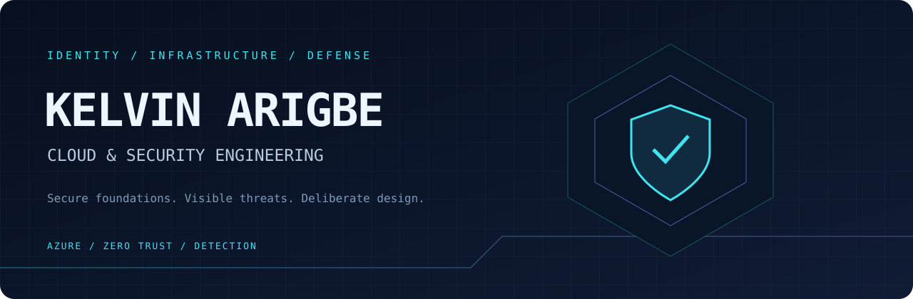

  <a href="https://github.com/KelvinArigbe/northstar-cloud-security"><b>Explore Northstar ↗</b></a>
  &nbsp; · &nbsp;
  <a href="https://github.com/KelvinArigbe?tab=repositories">All repositories</a>

## Building security into the cloud

I'm Kelvin, based in Lagos, Nigeria. My hands-on work focuses on Azure infrastructure, identity security, threat detection, and Zero Trust. I document the decisions behind my work: what could go wrong, how I would investigate it, and how I would reduce the risk.

**AZ-104 · AZ-500 · Master of Information Technology, Cybersecurity**

### Engineering focus

| Area | Tools and approaches |
| :--- | :--- |
| Cloud infrastructure | Azure · Network security · Azure Policy · Key Vault |
| Identity and access | Microsoft Entra ID · RBAC · Conditional Access · PIM |
| Detection and response | Microsoft Sentinel · KQL · Defender for Cloud · Incident investigation |
| Automation | Terraform · Bicep · Python · PowerShell |

### Selected work

**[01 / NORTHSTAR — Cloud Security Engineering](https://github.com/KelvinArigbe/northstar-cloud-security)**  
Hands-on cases spanning infrastructure security, IAM, infrastructure as code, detection, incident response, networking, and Zero Trust. A growing record of practical investigation and engineering decisions.

**[02 / TRACEGUARDIAN — Azure Monitoring](https://github.com/KelvinArigbe/TraceGuardian)**  
An Azure cloud security project focused on monitoring and Microsoft Sentinel integration.

**[03 / ZERO TRUST — Simulation](https://github.com/KelvinArigbe/zero-trust-simulation)**  
A Python simulation project exploring Zero Trust concepts.

<b>More projects</b>

- [SecureBastion](https://github.com/KelvinArigbe/SecureBastion)
- [SecureBank-Pro](https://github.com/KelvinArigbe/SecureBank-Pro)

### Current direction

Developing deeper cloud security engineering skills through practical cases, while expanding into AWS, DevOps, and AI for security.

Interested in **cloud infrastructure, cloud security, SOC, and IAM opportunities**.

---

VERIFY EXPLICITLY &nbsp; / &nbsp; USE LEAST PRIVILEGE &nbsp; / &nbsp; ASSUME BREACH

