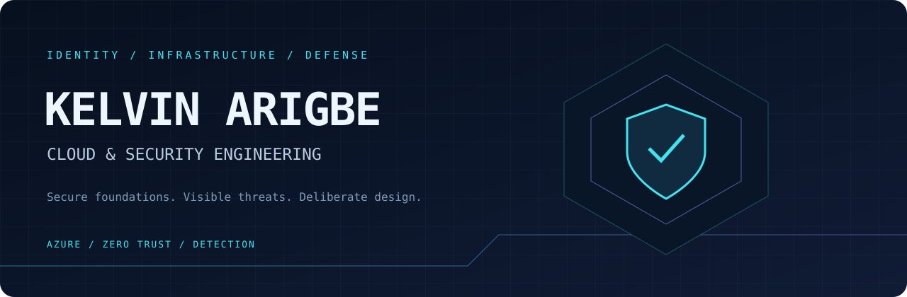

  <a href="https://github.com/KelvinArigbe/azure-devsecops-netflix"><b>Azure DevSecOps Project ↗</b></a>
  &nbsp; · &nbsp;
  <a href="https://github.com/KelvinArigbe/northstar-cloud-security"><b>Cloud Security Case Studies ↗</b></a>
  &nbsp; · &nbsp;
  <a href="https://github.com/KelvinArigbe?tab=repositories">All repositories</a>

## Building and securing cloud systems

I'm Kelvin, based in Lagos, Nigeria. I focus on **Azure cloud security, identity and access management, infrastructure security, and DevSecOps delivery**.

I build practical labs and engineering case studies around real operational questions: how should access be restricted, how can cloud misconfigurations be detected, how do we secure a delivery pipeline, and how do we prove that a remediation works?

My portfolio distinguishes between deployed lab work, validated code, simulations, and architecture proposals. Each project documents its evidence and remaining limitations.

## Engineering focus

| Area | Tools and technologies |
| :--- | :--- |
| Cloud platform | Microsoft Azure, Azure CLI, Azure Policy, Key Vault |
| Identity and access | Microsoft Entra ID, Azure RBAC, least privilege, Conditional Access, Managed Identity |
| Infrastructure as Code | Terraform, Bicep |
| DevSecOps | GitHub Actions, Docker, Azure Container Registry, Trivy |
| Monitoring and security operations | Microsoft Defender for Cloud, Log Analytics, KQL, Microsoft Sentinel |
| Scripting and systems | PowerShell, Python, Linux |

## Selected projects

### 01 — [Azure DevSecOps Netflix-Style Application](https://github.com/KelvinArigbe/azure-devsecops-netflix)
**Container security · CI/CD · Azure deployment**

Built a GitHub Actions pipeline for a React/TypeScript application using Docker, Trivy vulnerability scanning, Azure Container Registry, and an Azure Linux VM. The deployment uses the VM's managed identity, checks a candidate container before replacing production, and includes a rollback path. The deployed container was verified with an HTTP 200 response.

*Current boundary:* the deployment job rebuilds the image on the VM rather than promoting the exact image digest scanned by the hosted runner. Terraform provisioning and runtime monitoring remain future work.

### 02 — [Azure IAM Access Review and Least-Privilege Remediation](https://github.com/KelvinArigbe/azure-iam-least-privilege)
**Entra ID · Azure RBAC · Custom roles · PowerShell**

Tested how direct and group-based role assignments affect effective access in a personal Azure lab. Replaced broad Contributor access with Reader, investigated additive permissions, and created a narrowly scoped custom role for tag maintenance. Includes a PowerShell audit script with documented scope and limitations.

### 03 — [Azure Blob Storage Security Lab](https://github.com/KelvinArigbe/azure-blob-storage-security)
**Storage security · Entra ID · Shared Key · PowerShell**

Reproduced anonymous blob access, disabled account-level public access, and verified that authorised reads still worked through Microsoft Entra ID. Also disabled Shared Key access, checked HTTPS and TLS settings, and documented the remaining network and logging gaps.

### 04 — [Northstar Cloud Security](https://github.com/KelvinArigbe/northstar-cloud-security)
**Terraform · Incident investigation · Detection engineering · Zero Trust**

A collection of five security case studies covering Azure infrastructure review, Entra ID compromise, Linux workload compromise, excessive privilege, and secure network design. Terraform formatting and validation run in GitHub Actions.

*Current boundary:* the incidents use synthetic lab evidence; the network architecture is a design proposal, and no Azure resources are deployed by this repository.

### 05 — [SecureBank Pro](https://github.com/KelvinArigbe/SecureBank-Pro)
**Node.js · Bicep · Key Vault · Managed Identity · CI validation**

A security-focused application and Azure infrastructure prototype. Includes an Express API with tests and Bicep templates for selected application, identity, Key Vault, and database components. GitHub Actions runs application tests and Bicep compilation.

*Current boundary:* the application does not yet connect to the SQL database, and successful Bicep compilation is not evidence of a live Azure deployment.

### 06 — [SecureBastion](https://github.com/KelvinArigbe/SecureBastion)
**Azure security architecture · Bicep · IAM · Monitoring**

An Azure security architecture simulation covering identity, administration, network protection, data protection, threat protection, monitoring, and security operations. Includes configuration examples, synthetic events, and documented remediation patterns.

*Current boundary:* this is an architecture and configuration simulation, not proof that every listed Azure control was deployed.

## Certifications and education

- Microsoft Certified: Azure Administrator Associate (AZ-104)
- Microsoft Certified: Azure Security Engineer Associate (AZ-500)
- Google Cybersecurity Professional Certificate
- Master of Information Technology, Cybersecurity — Distinction
- B.Sc. Geomatics

**Currently developing:** Microsoft Cybersecurity Architect (SC-100).

## Roles of interest

Cloud Security Engineer · DevSecOps Engineer · IAM Analyst / Engineer · Cloud Security Analyst

I'm interested in roles where I can secure cloud infrastructure, strengthen identity controls, automate security checks, and improve how engineering teams build and deploy software.

---

VERIFY EXPLICITLY &nbsp; / &nbsp; USE LEAST PRIVILEGE &nbsp; / &nbsp; AUTOMATE SECURITY &nbsp; / &nbsp; ASSUME BREACH

